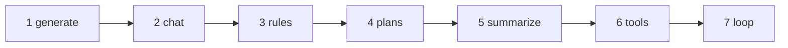
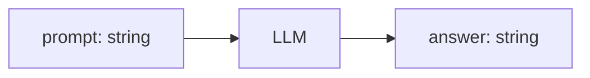
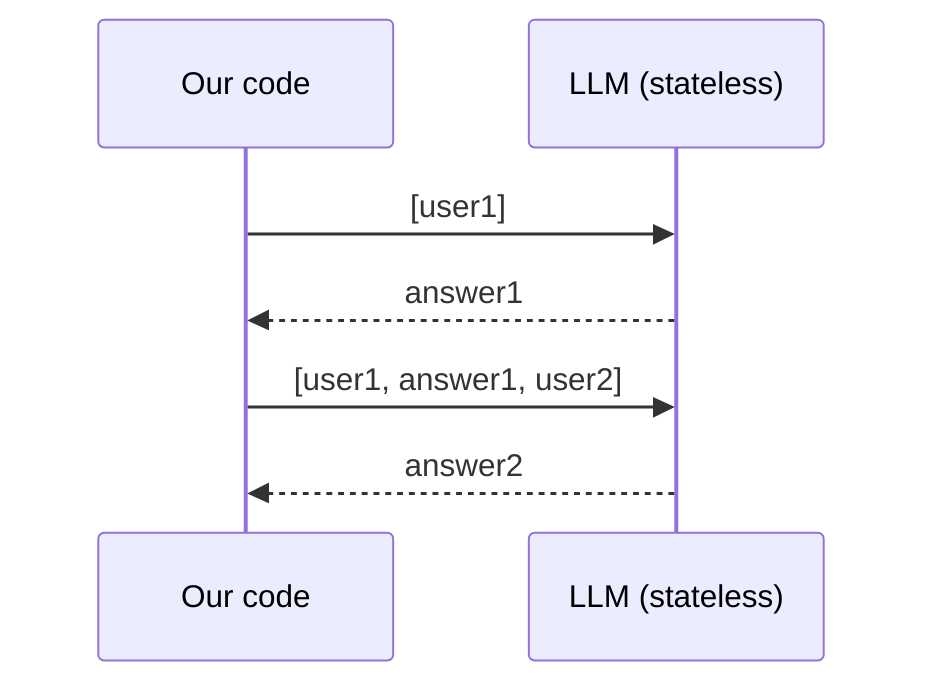
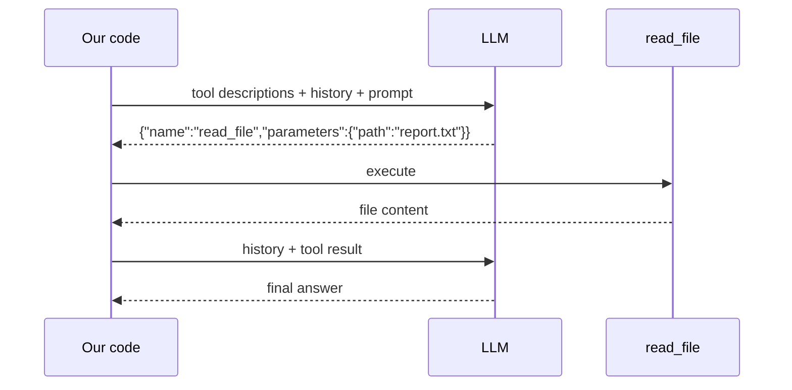
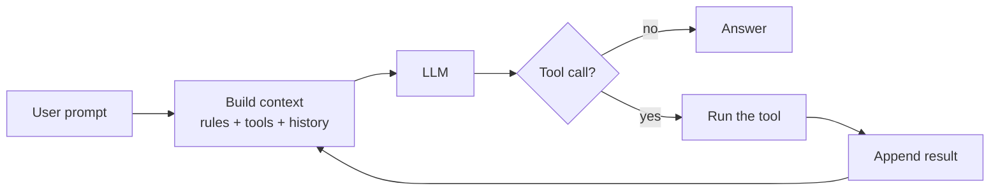
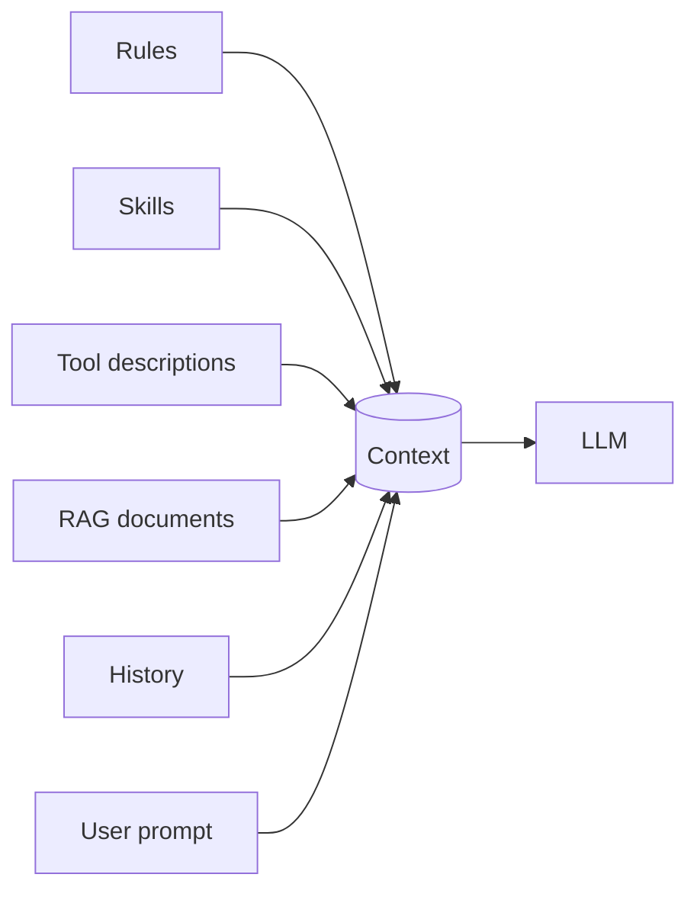
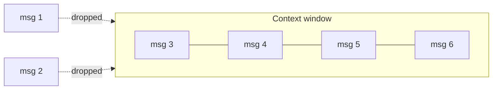

<!-- _class: lead -->
<!-- _paginate: false -->

# It's all about prompting

*by Enrico Sasdelli*

<!--
Talk as a journey of discovery: start from a question and build an AI agent one piece at a time, live.
Render: npm run slides (HTML) / npm run slides:pdf. Run every demo with --debug.
-->

---

<!-- _class: lead -->

# How does an AI agent work?

Answers, chats, reasons, follows rules, makes plans,
reads and writes files, runs commands...

**How does it remember things?**
**How does it invoke tools?**

<!-- Spoiler: it is simpler than it looks. Let's build one. -->

---

# Let's build one

Each step adds **one idea** on top of the previous one.



<!-- Run every demo with --debug to see the exact request, the response and the token counters. -->

---

# 1. Generate

**An LLM is a `String -> String` function.**



- One request, one answer, nothing remembered
- It is a single HTTP POST with JSON

`01_00_generate.mjs` · `01_01_generate.mjs`

<!-- Show --debug. Ask the same thing twice: the model has no clue about the first time. -->

---

# Tokens

The model does not read words, it reads **tokens**.

- Text is split into tokens: sub-words, punctuation, spaces
- `[Prompt, Response, Total]` printed by the demos counts tokens
- Tokens are also what the bill, the speed and the limits are measured in

<!-- Live: open Tiktokenizer, paste a sentence, show how it is split. -->

---

# 2. Chat and memory

**The LLM has no memory. We resend the whole conversation every time.**



"Memory" = an array we keep and resend

---

# Three ways to chat

1. `02_01` history glued in one string (`USER:` / `SYSTEM:`)
   the model just **continues the text**
2. `02_02` same, with the **special tokens** the model was trained on
3. `02_00` the `/api/chat` endpoint with a `messages` array
   the server does the formatting of `02_02` for us

---

<!-- _class: small -->

# Special tokens: how the model sees a chat

The model receives **one flat sequence of tokens**. Special tokens mark who is speaking (Llama 3, as in `02_02`):

```text
<|begin_of_text|>
<|start_header_id|>system<|end_header_id|>

You are a helpful assistant.<|eot_id|>
<|start_header_id|>user<|end_header_id|>

Hi!<|eot_id|>
<|start_header_id|>assistant<|end_header_id|>

```

- `<|eot_id|>` ends a turn: the model learned to **emit it when done**
- Templates are **model specific** (Llama, Mistral, ChatML `<|im_start|>`...)
- User text containing these tokens must not be read as structure

---

# 3. Rules

**A rule is a system message loaded from a file.**

- `rules/02_rule.txt`: answer in HTML
- `rules/02_rule_2.txt`: snake_case Java

`03_rules.mjs`

<!-- Ask a question, delete the rule file, ask again: same model, different behaviour, because the prompt changed. -->

---

# 4. Plans

**A `/plan` command is a prompt template.**

- It expands to a longer prompt
- Commands, skills, "plan mode": no magic, just **text injected into the context**

`04_plan.mjs`

---

# 5. Summarize

**The history grows forever: ask the LLM to compress it.**

- Replace the history with the summary
- The context shrinks, but **details are lost**
- A trade-off, not a free lunch

`05_summarize.mjs`

<!-- Live: run /summarize and compare token counters before and after. -->

---

# 6. Tools

**The LLM never executes anything.**
It receives the *description* of the tools and answers with the *command it wants to invoke*. Our code runs it.



---

# Two flavours of tools

1. `06_02` **prompt only**: descriptions in a system prompt, the model replies with JSON that **we parse**. It is just text.
2. `06_01` **native**: we send the `tools` field. The server renders the descriptions with the model's own template (special tokens again) and parses the reply into `tool_calls`.

Same mechanism, better formatting.

<!-- Show --debug: the model only ever returns text. -->

---

# 7. The loop

**An agent is a loop around an LLM call.**



<!-- In 06_01 the tool is called once, then the model answers. Remove that limit: loop while the model asks for tools. That is an agent. -->

---

<!-- _class: lead -->

# Recap

---

# Four ideas to remember

1. **An AI agent is a loop around an LLM call**
2. **Tools run outside the LLM**: it receives their description and answers with the command it wants to invoke
3. **Everything is prompt**: tools, skills, rules and RAG reduce to text passed to the LLM
4. **All of it together is the context**, the only thing an LLM sees

---

<!-- _class: small -->

# Everything is prompt

| Term    | In one line                              | What the LLM gets                |
|---------|------------------------------------------|----------------------------------|
| Rule    | Text always added                        | A system message                 |
| Skill   | Instructions loaded only when needed     | Extra text in the prompt         |
| Command | Shortcut that expands to a prompt        | The expanded prompt              |
| Tool    | A function the LLM can ask us to run     | A description of the function    |
| RAG     | Documents retrieved from a store         | Retrieved text pasted in         |
| Memory  | The conversation so far                  | All previous messages, resent    |

---

# The context



**The context is the only thing an LLM sees.**

---

# The Agentic Illusion

- LLMs have no state, no memory, no history
- They cannot escape their box

**but...**

it is the most powerful `String -> String` function ever created

Memory, tools and planning live **in our code** and reach the model only as text.

---

<!-- _class: lead -->

# Deep dive: context

---

# A bigger context is not necessarily better

- **O(n²)**: attention compares every token with every other, doubling the context roughly quadruples the compute
- **Hard limit**: positional embeddings are trained up to a maximum length
- **Sliding window**: when full, the oldest messages are dropped, rules and goal included
- **Attention dilution**: long contexts are used worse, especially "in the middle"
- **Pollution**: irrelevant, outdated or wrong text steers the answer
- **Latency and price** grow on every turn, the whole context is resent

---

# Sliding window



**Put in the context what is needed, not what is available.**
That is why we summarize, retrieve (RAG) and load skills on demand.

---

# Prompt caching

The context is resent every turn, and most of it is identical to the last request.
The server caches the **already computed prefix** (the KV cache) and processes only the new tokens.

- Works only on a **stable prefix**: rules, tools, history first, what changes last
- Editing something at the start invalidates everything after it
- Cached tokens are cheaper and faster. Locally, Ollama can reuse the prefix, so `prompt_eval_count` may drop on follow-up turns
- It saves compute, not the window

<!-- Verify the Ollama behaviour with --debug before the talk. -->

---

# Prompt injection

The model cannot tell **our** instructions from instructions hidden in the **data** it reads: it is all one stream of tokens.

<!-- Live: with 06_01_tools.mjs ask "read demo/injection.txt and summarize it". Does the agent obey the hidden instruction? -->

---

# What's next

- **MCP**: tools exposed by external servers instead of functions in our code
- Better memory: persisting summaries and facts between sessions
- Guardrails against prompt injection

---

<!-- _class: lead -->

# Takeaway

**Agent = a loop around an LLM call**

tools run **outside** the LLM · tools, skills, rules and RAG are all **prompt** · the **context** is all the LLM sees

---

<!-- _class: small -->

# References

- [This repository](https://github.com/ilsasdo/its-all-about-prompting): the demos of this talk
- The article that inspired this talk
- How LLM works (ITA), Pinperepette
- Claude Source Code explained, Pinperepette
- Tiktokenizer, Tokenization Visualized
- Transformer Visualized
- MicroGPT, GPT training and inference in 200 loc
- [LLM visualization](https://bbycroft.net/llm): a 3D walk-through of a GPT

---

<!-- _class: lead -->
<!-- _paginate: false -->

# Thank you :)

*Leave me feedback!*

<script type="module">
  import mermaid from 'https://cdn.jsdelivr.net/npm/mermaid@11/dist/mermaid.esm.min.mjs';
  mermaid.initialize({ startOnLoad: false, theme: 'default' });
  await mermaid.run({ querySelector: 'pre.mermaid' });
</script>
