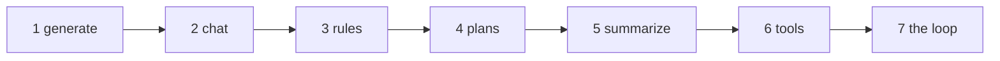
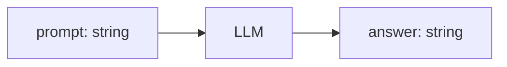
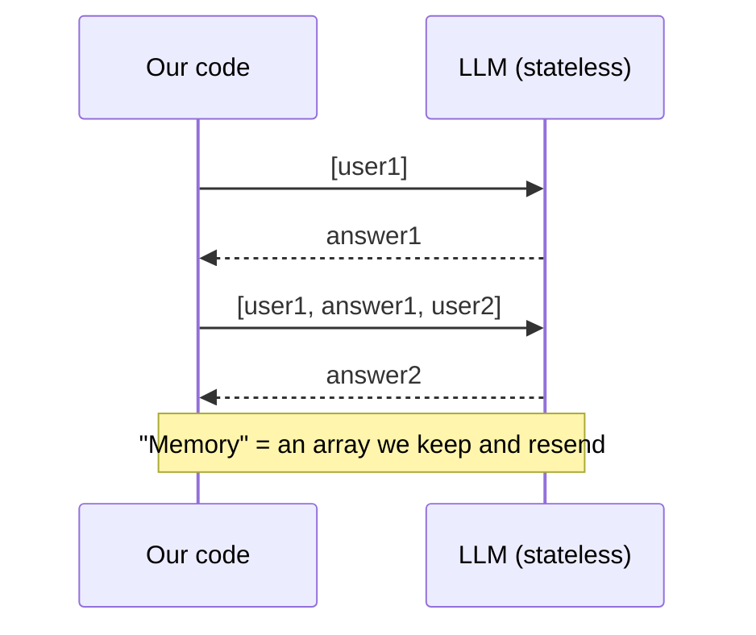
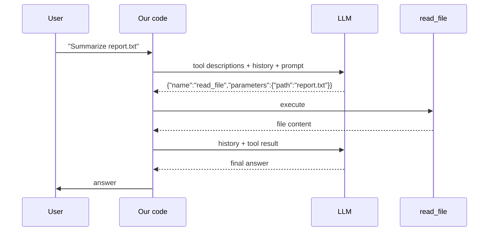
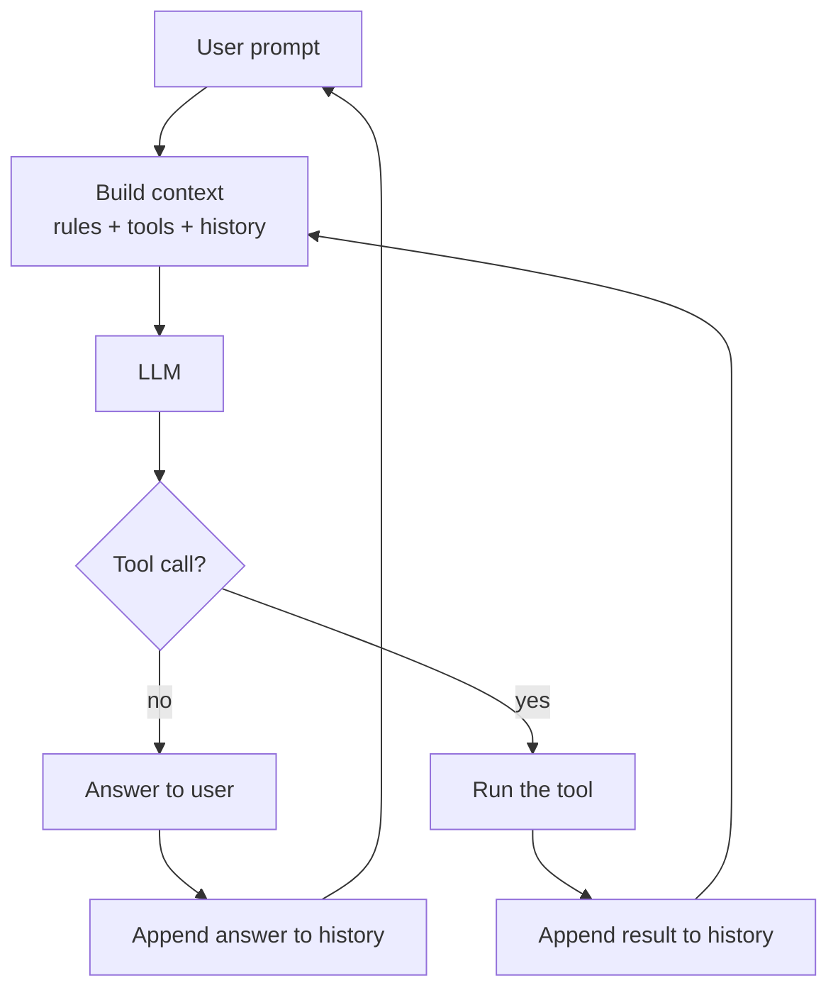
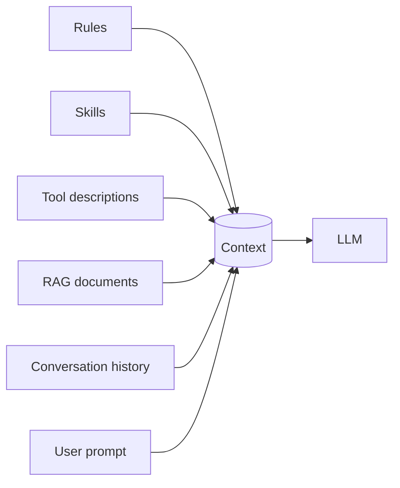
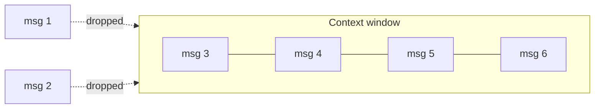

# It's all about prompting
*by Enrico Sasdelli*

A talk built as a journey of discovery: we start from a question and **build an AI agent one piece at a time**, live. Slides frame each step, the code does the talking, and a recap closes the talk.

---

# Part 1: The question

## 1. How does an AI agent work?

> "AI agents answer, chat, reason, follow rules, make plans, read and write files, run commands... **but how?**"

Two questions to answer by the end of the talk:

1. **How does it remember things?**
2. **How does it invoke tools?**

*Spoiler: it's much simpler than it looks. Let's build one.*

---

# Part 2: Live coding, one piece at a time

Each step adds **one idea** on top of the previous one. Run every demo with `--debug` to see the exact request and response, and the token counters.



## Step 1: Generate (`01_00_generate.mjs`, `01_01_generate.mjs`)

**Idea:** an LLM is a `String -> String` function.



- One request, one answer. Nothing is remembered: ask the same thing twice, the model has no clue.
- Show `--debug`: the whole thing is a single HTTP POST with JSON.

*Technical note: the model does not read words, it reads **tokens**.* Open Tiktokenizer, paste a sentence, and show how it is split. The `[Prompt, Response, Total]` counter printed by the demo counts tokens, and so does the bill.

## Step 2: Chat and memory (`02_00_chat.mjs`, `02_01_chat.mjs`, `02_02_chat.mjs`)

**Idea:** the LLM has no memory. **We** resend the whole conversation every time.



Walk through the three versions, from the most naive to the most real:

1. `02_01`: history glued into a single string with `USER:` / `SYSTEM:` prefixes. It works, because the model just continues the text.
2. `02_02`: the same, with the **special tokens** the model was trained on.
3. `02_00`: the `/api/chat` endpoint with a `messages` array. The server does the formatting from `02_02` for us.

### Special tokens: how the model sees a chat

The model does not know what a "chat" is. It receives one flat sequence of tokens, where **special tokens** mark who is speaking. Llama 3 example (the exact text used in `02_02`):

```text
<|begin_of_text|>
<|start_header_id|>system<|end_header_id|>

You are a helpful assistant.<|eot_id|>
<|start_header_id|>user<|end_header_id|>

Hi!<|eot_id|>
<|start_header_id|>assistant<|end_header_id|>

```

- `<|eot_id|>` ends a turn. The model learned to **emit it when it is done**; generation stops there.
- The template is **model specific**: Llama, Mistral, ChatML (`<|im_start|>`) and others each use different tokens. That is the job of the chat API.
- These tokens are also a security boundary: user text that contains them should not be interpreted as structure.

## Step 3: Rules (`03_rules.mjs`, `rules/`)

**Idea:** a rule is just a **system message** loaded from a file.

- Show `rules/02_rule.txt` (answer in HTML) and `rules/02_rule_2.txt` (snake_case Java).
- Ask a question, then delete the rule file and ask again: same model, different behaviour, because the **prompt** changed.

## Step 4: Plans (`04_plan.mjs`)

**Idea:** a `/plan` command is a **prompt template** that expands to a longer prompt.

- Commands, skills and "plan mode" are not magic features: they are text injected into the context.

## Step 5: Summarize (`05_summarize.mjs`)

**Idea:** the history grows forever, so we ask the LLM to **compress it**, then replace the history with the summary.

- Run `/summarize` and compare the token counters before and after.
- The context shrinks, but **details are lost**. It is a trade-off, not a free lunch.

## Step 6: Tools (`06_02_tools.mjs`, then `06_01_tools.mjs`)

**Idea:** the LLM **never executes anything**. It receives the *description* of the tools and answers with the *command it wants to invoke*. Our code runs it.



1. `06_02` (prompt only): the tool descriptions are in a system prompt, the model replies with a JSON that **we parse**. It is just text.
2. `06_01` (native): we send the `tools` field of the API. The server renders the descriptions into the model's own template (special tokens again) and parses the reply back into `tool_calls`. Same mechanism, with better formatting.

Show `--debug` here: the model only ever returns text.

## Step 7: The loop

**Idea:** an agent is a **loop around an LLM call**.



- In `06_01` the tool is called once, then the model answers. Remove that limit: keep looping **while the model asks for tools**. That is an agent.
- Everything we added is a piece of this diagram: history (memory), rules, tools, summarize (context management).

---

# Part 3: Recap

## 2. Four ideas to remember

1. **An AI agent is a loop around an LLM call**
2. **Tools run outside the LLM**: it only receives their description and answers with the command it wants to invoke
3. **Everything is prompt**: tools, skills, rules and RAG all reduce to text passed to the LLM
4. **All of it together is the context**, and the context is the only thing an LLM sees

## 3. Everything is prompt

| Term    | In one line                                                 | What the LLM actually gets              |
|---------|-------------------------------------------------------------|-----------------------------------------|
| Rule    | Text always added (`rules/*.txt`)                           | A system message                        |
| Skill   | Instructions loaded only when needed                        | Extra text in the prompt                |
| Command | A shortcut that expands to a prompt (`/plan`, `/summarize`) | The expanded prompt                     |
| Tool    | A function the LLM can ask us to run                        | A description of the function           |
| RAG     | Documents retrieved from a store                            | The retrieved text pasted in the prompt |
| Memory  | The conversation so far                                     | All previous messages, resent each time |



## 4. The Agentic Illusion

- LLMs have no state, no memory, no history, and cannot escape their box
- **but...** it is the most powerful `String -> String` function ever created
- Memory, tools and planning all live **in our code**, and reach the model only as text

---

# Part 4: Technical deep dive: context

> **The context is the only thing an LLM sees.**

## 5. Why a bigger context is not necessarily better

- **Cost grows quadratically, O(n²)**: attention compares every token with every other token, so doubling the context roughly quadruples the compute
- **Hard limit**: positional embeddings are trained up to a maximum length; beyond it the model cannot see
- **Sliding window**: when it is full, the oldest messages are dropped, and the model forgets the rules and the goal that were at the start



- **Big ≠ best**: attention is diluted, and models tend to use information at the start and end of a long context better than the middle ("lost in the middle")
- **Context pollution**: irrelevant, outdated or wrong text steers the answer
- **Latency and price** grow with every token, on every turn, because the whole context is resent

### Prompt caching: not recomputing what was already computed

Since the whole context is resent every turn, most of it is identical to the previous request. The server can **cache the already computed prefix** (the attention keys/values, the "KV cache") and only process the new tokens.

- It works only on a **stable prefix**: put rules, tool descriptions and history first, and what changes last. Editing something at the start invalidates everything after it.
- Providers bill cached input tokens at a discount and respond faster. Locally, Ollama reuses the KV cache between requests with the same prefix, which is why `prompt_eval_count` can drop on follow-up turns.
- Cost still grows with context size: the cache saves compute, not the window itself.

**Practical rule:** put in the context *what is needed*, not *what is available*. This is why we summarize, retrieve (RAG) and load skills on demand.

## 6. Prompt injection

The model cannot tell **our** instructions from instructions hidden in the **data** it reads: it is all one stream of tokens.

*Live:* with `06_01_tools.mjs` ask "read `demo/injection.txt` and summarize it". Does the agent obey the hidden instruction?

## 7. What's next

- **MCP**: tools exposed by external servers, instead of functions in our code
- Better memory: persisting summaries and facts between sessions
- Guardrails against prompt injection

## 8. Takeaway

> **Agent = a loop around an LLM call**
>
> - tools run **outside** the LLM: it only describes what it wants to call
> - tools, skills, rules and RAG are all just **prompt**
> - the **context** is the only thing the LLM sees

## 9. Thank you :)

## References

- [This repository](https://github.com/ilsasdo/its-all-about-prompting): the demos of this talk
- The article that inspired this talk
- How LLM works (ITA), Pinperepette: an introduction to how LLMs work
- Claude Source Code explained, Pinperepette: how a real coding agent is built
- Tiktokenizer, Tokenization Visualized: see how text becomes tokens
- Transformer Visualized: the architecture step by step
- MicroGPT, GPT training and inference in 200 loc: the smallest working GPT
- [LLM visualization](https://bbycroft.net/llm): a 3D walk-through of a GPT

*Leave me feedback!*
