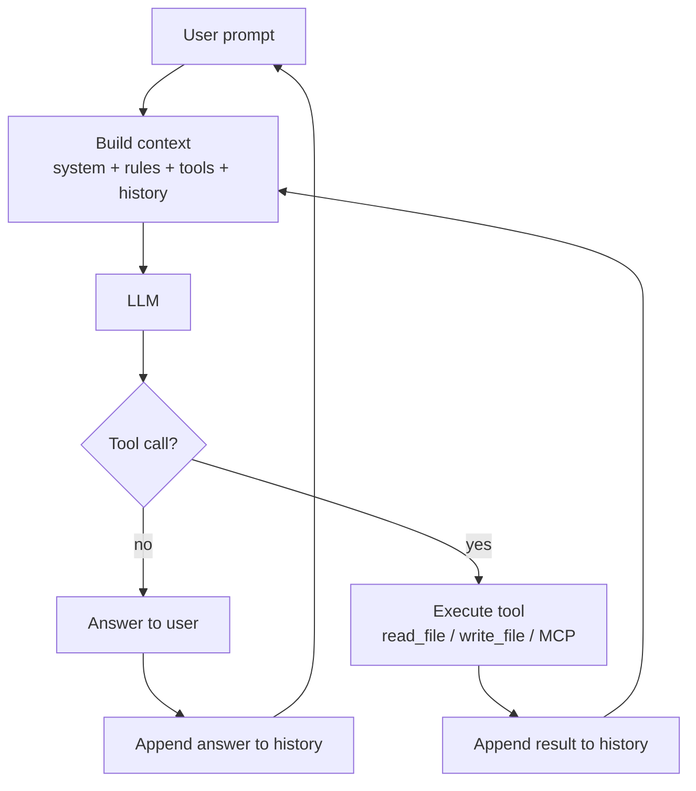
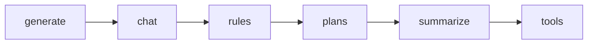
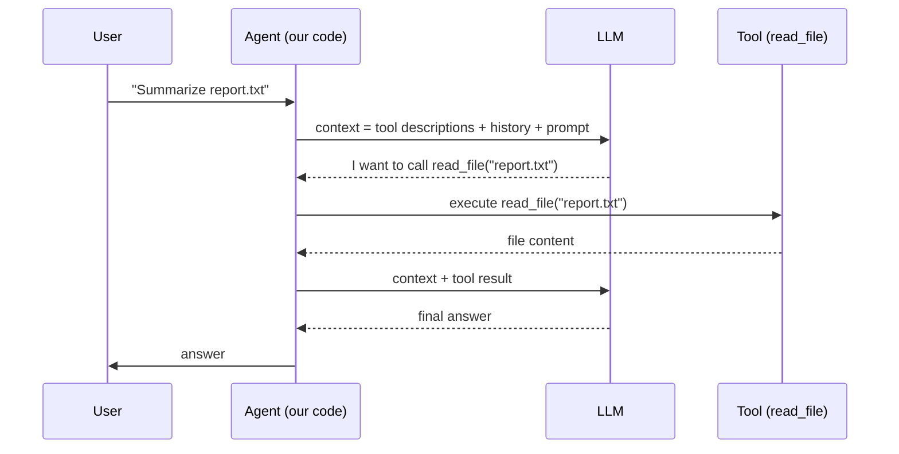
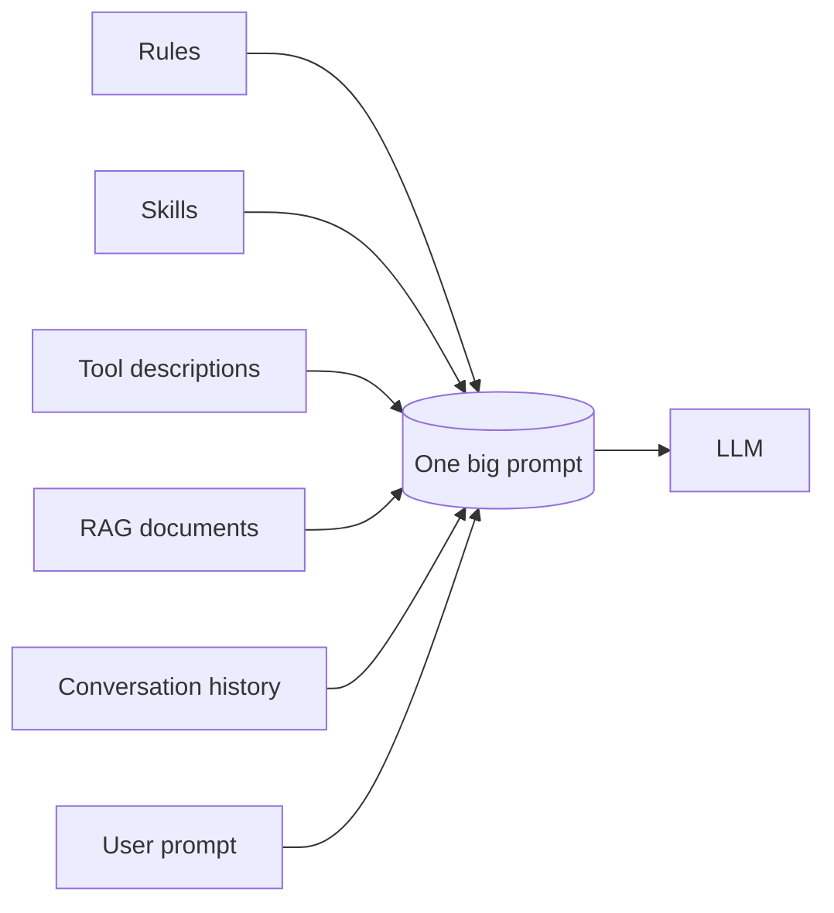
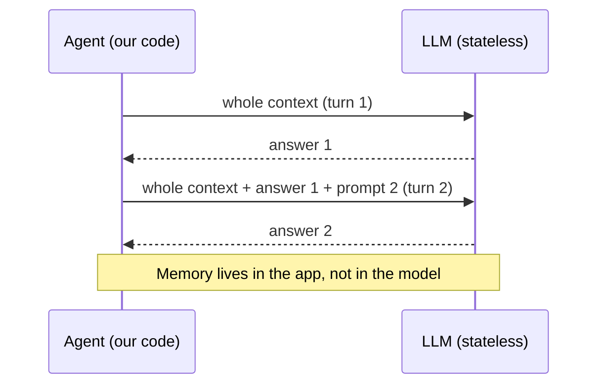
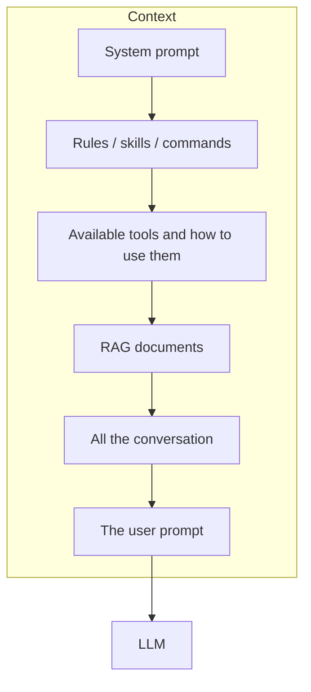
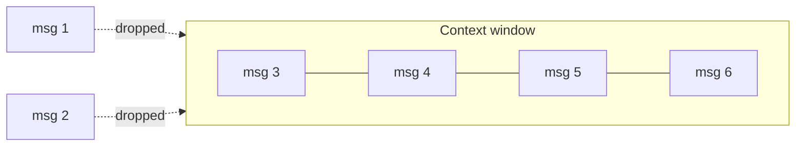

# It's all about prompting
*by Enrico Sasdelli*

---

## 1. AI Jargon: "Agents, agents, agents…"

An agent:

- Answers questions
- Chats
- Can reason and explain
- Follows Rules and Skills we give it
- Creates Plans for complex tasks
- Reads and writes files, surfs the web
- Executes Commands / MCPs
- *Seems* to remember what it did

> … let's break it down

---

## 2. Four ideas to remember

1. **An AI agent is a loop around an LLM call**
2. **Tools run outside the LLM**: it only receives their description and answers with the command it wants to invoke
3. **Everything is prompt**: tools, skills, rules and RAG all reduce to text passed to the LLM
4. **All of it together is the context**, and the context is the only thing an LLM sees

---

## 3. The agent is a loop around an LLM call

> **Agent = a `while` loop around one LLM call.**

Everything an agent does is this loop. The rest of the talk fills in each box.

---

## 4. Agent breakdown

Each capability is one small step on top of the previous demo:

| Concept   | What it adds                         | Demo                                                 |
|-----------|--------------------------------------|------------------------------------------------------|
| generate  | one prompt in, one answer out        | `01_00_generate.mjs`, `01_01_generate.mjs`           |
| chat      | we resend the history every turn     | `02_00_chat.mjs`, `02_01_chat.mjs`, `02_02_chat.mjs` |
| rules     | a system prompt loaded from files    | `03_rules.mjs` + `rules/`                            |
| plans     | a reusable `/plan` prompt            | `04_plan.mjs`                                        |
| summarize | `/summarize` shrinks the history     | `05_summarize.mjs`                                   |
| tools     | the model asks, our code executes    | `06_01_tools.mjs`, `06_02_tools.mjs`                 |

MCP is the standard way to plug tools into an agent. It is not demoed here, see "What's next".

**Coding time**

---

## 5. Tools live outside the LLM

The LLM never runs anything. It receives the **description** of the available tools as text, and replies with **the command it wants to invoke**. Our code runs it and sends the result back.

*Demo:* `06_02_tools.mjs` (the tool call is just JSON in the reply) and `06_01_tools.mjs` (same idea via the API `tools` field). Run with `--debug` to see that the model only ever returns text.

---

## 6. Everything is prompt

Tools, skills, rules, RAG, commands: different names, same mechanism. They are all **text concatenated into the prompt**.

| Term    | In one line                                               | What the LLM actually gets                |
|---------|-----------------------------------------------------------|-------------------------------------------|
| Rule    | Text always added (`rules/*.txt`)                         | A system message                          |
| Skill   | Instructions loaded only when needed                      | Extra text in the prompt                  |
| Command | A shortcut that expands to a prompt (`/plan`, `/summarize`) | The expanded prompt                     |
| Tool    | A function the LLM can ask us to run                      | A description of the function             |
| RAG     | Documents retrieved from a store                          | The retrieved text pasted in the prompt   |

---

## 7. The Agentic Illusion

- LLMs have no state
- No memory
- No history
- It cannot escape its box

**but…**

> It's the most powerful `String -> String` function ever created.

---

## 8. It's all about context

> **The context is the only thing an LLM sees.** Prompt, rules, skills, tools and RAG together make up the context.

### 8.1 Content

*Live:* run any demo with `--debug` and look at `[Prompt, Response, Total]` tokens grow turn after turn.

### 8.2 Size

- **O(n²)**: attention compares every token with every other token, so doubling the context roughly quadruples the cost
- **Maximum positional embeddings**: the model was trained for a maximum length and cannot see beyond it
- **Sliding context window**: old messages are dropped when the window is full

*Live:* run `/summarize` in `05_summarize.mjs` and compare the token count before and after. The context shrinks, but detail is lost.

### 8.3 Issues

- **Big ≠ best**: more context means more cost and more noise
- **Context pollution**: irrelevant or wrong text steers the answer
- **Prompt injection**: the model cannot tell our instructions from instructions hidden in the data it reads

*Live:* with `06_01_tools.mjs`, ask: "read `demo/injection.txt` and summarize it". Does the agent obey the hidden instruction?

---

## 9. What's next

- **MCP**: tools exposed by external servers instead of functions in our code
- Better memory: persisting summaries and facts between sessions
- Guardrails against prompt injection

---

## 10. Takeaway

> **Agent = a loop around an LLM call**
>
> - tools run **outside** the LLM: it only describes what it wants to call
> - tools, skills, rules and RAG are all just **prompt**
> - the **context** is the only thing the LLM sees

---

## 11. Thank you :)

## References

- [This repository](https://github.com/ilsasdo/its-all-about-prompting): the demos of this talk
- The article that inspired this talk
- How LLM works (ITA), Pinperepette: an introduction to how LLMs work
- Claude Source Code explained, Pinperepette: how a real coding agent is built
- Tiktokenizer, Tokenization Visualized: see how text becomes tokens
- Transformer Visualized: the architecture step by step
- MicroGPT, GPT training and inference in 200 loc: the smallest working GPT
- [LLM visualization](https://bbycroft.net/llm): a 3D walk-through of a GPT

*Leave me feedback!*
