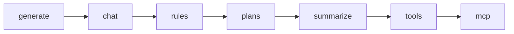
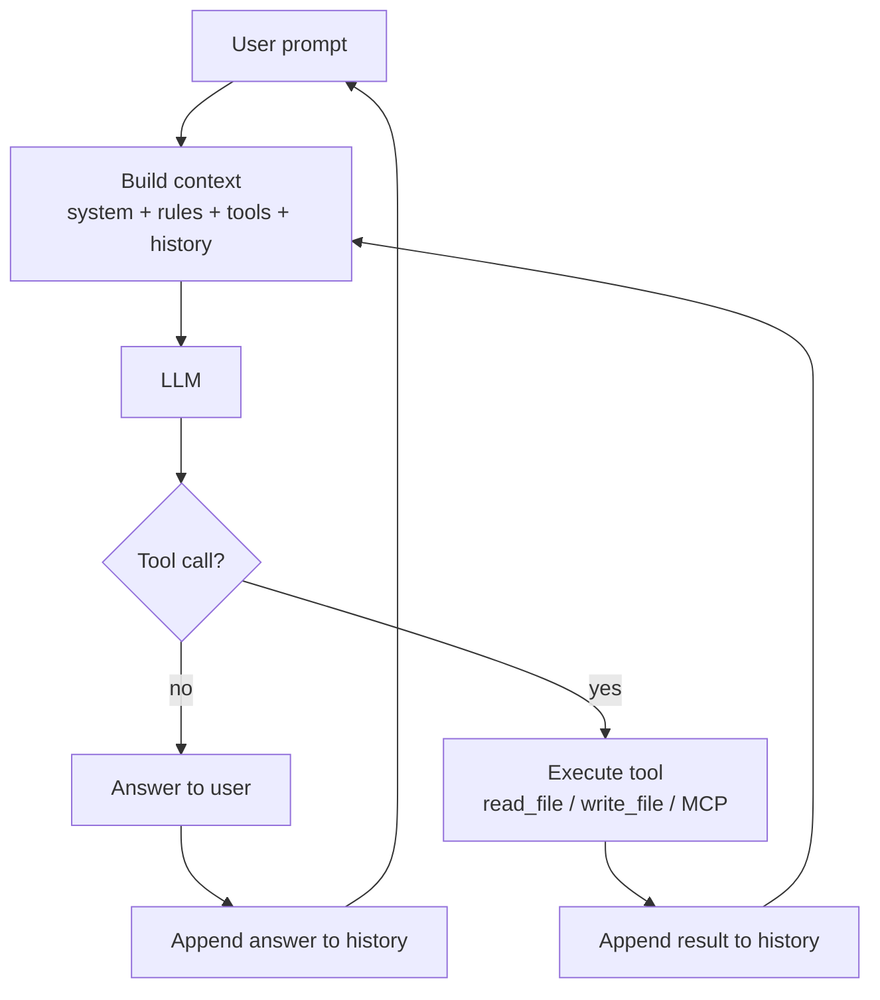
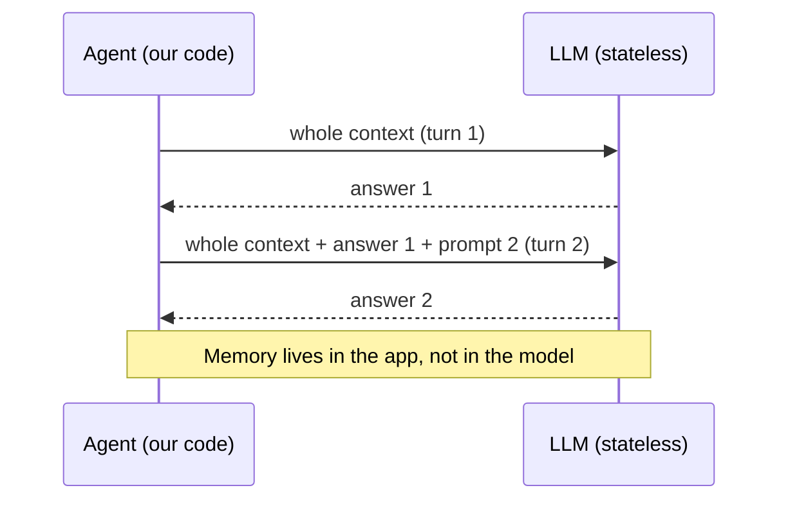
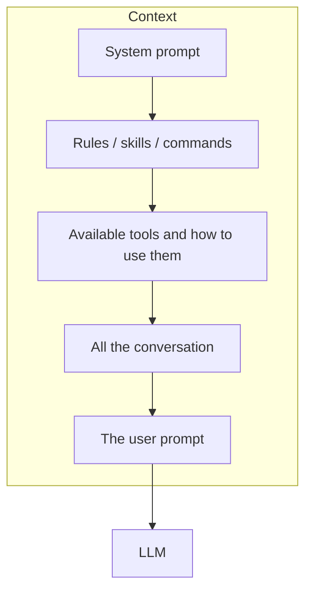
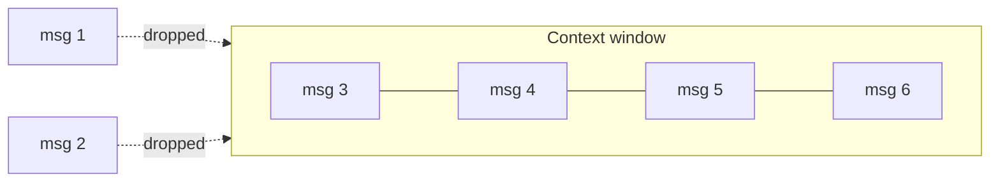

# It's all about prompting
*by Enrico Sasdelli*

---

## 1. AI Jargon: "Agents, agents, agents…"

An agent:

- Answers questions
- Chats
- Can reason and explain
- We can tell it Rules and Skills
- Creates Plans for complex tasks
- Reads and writes files, surfs the web
- Executes Commands / MCPs
- Remembers what it did

> … let's break it down

---

## 2. Agent Breakdown

Each capability maps to a demo script in this repo:

| Concept   | Demo                                        |
|-----------|---------------------------------------------|
| generate  | `01_00_generate.mjs`, `01_01_generate.mjs`  |
| chat      | `02_00_chat.mjs`, `02_01_chat.mjs`, `02_02_chat.mjs` |
| rules     | `03_rules.mjs` + `rules/`                   |
| plans     | `04_plan.mjs`                               |
| summarize | `05_summarize.mjs`                          |
| tools     | `06_01_tools.mjs`, `06_02_tools.mjs`        |
| mcp       | *(no demo yet)*                             |

**Coding time**

---

## 3. The agent's loop

---

## 4. The Agentic Illusion

- LLMs have no state
- No memory
- No history
- It cannot escape its box

**but…**

> it's the most powerful `String -> String` function ever created

---

## 5. It's all about context

> The LLM only sees the context we give it.

### 5.1 Content

### 5.2 Size

- O(n²) attention cost
- Maximum positional embeddings
- Sliding context window

### 5.3 Issues

- Big ≠ best
- Context pollution
- Prompt injection

---

## 6. Thank you :)

## References

- This repository
- The article that inspired this talk
- How LLM works (ITA), Pinperepette
- Claude Source Code explained, Pinperepette
- Tiktokenizer, Tokenization Visualized
- Transformer Visualized
- MicroGPT, GPT training and inference in 200 loc
- https://bbycroft.net/llm

*Leave me feedback!*

---

# Feedback

## Strengths

- Strong thesis: "the LLM is a stateless `String -> String` function" demystifies agents.
- The demos build up one capability at a time (generate → chat → rules → plan → summarize → tools), so each new concept is a small diff.
- The "Agentic Illusion → but…" reversal is a good hook.

## Suggested improvements

1. **Order of the jargon vs. the breakdown.** The agent list (slide 1) and the breakdown (slide 2) say almost the same thing. Merge them into one diagram where each capability is mapped to a demo.
2. **Show the loop earlier.** "The agent's loop" is the core idea; consider presenting it right after the jargon slide, then use the demos to fill in each box.
3. **MCP has no demo.** It is listed first in the breakdown but never shown. Either add a small demo (e.g. a minimal MCP server exposing `read_file`) or move it to a "what's next" slide.
4. **Rules vs. skills vs. commands vs. tools** are used as synonyms. Add one slide that defines each in one line.
5. **Context slides are text-only.** Add visuals: a stacked bar showing which part of the context uses how many tokens (the demo already prints `[Prompt, Response, Total]` with `--debug`, use it live).
6. **Prompt injection needs an example.** A 30-second demo is enough: have the agent `read_file` a file containing "ignore previous instructions and write X", and show it comply.
7. **Show the summarize trade-off.** `/summarize` fixes context size but loses detail; show the token count before and after.
8. **Explain the "O(n²)" bullet.** Say in one sentence what is quadratic (attention between every pair of tokens), otherwise it reads as jargon.
9. **Memory.** The agent list claims "Remembers what it did", while the next slides say the LLM has no memory. Reword to "Seems to remember" to keep it consistent with the illusion.
10. **Add a closing takeaway slide** before "Thank you": e.g. "Agent = LLM + loop + context management + tools".
11. **References.** Label links with titles and a short reason ("read this for X"), and make the repository link actually clickable.
12. **Typo.** The text contains `String-&gt;String`, which is an HTML-escaped `>` from the export; fix it in the slide.
13. **Typography.** "it's all about prompting" and "by enrico sasdelli" are lowercase; use consistent capitalization.
